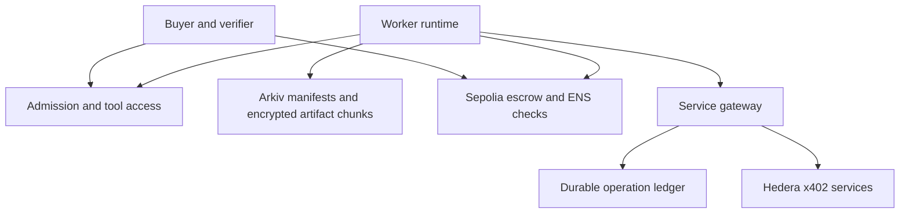

# BATON architecture

Revision: 6 November 2026. Status: target architecture with implementation evidence and limits recorded below; the complete live workflow is not deployed or verified. Arkiv, ENS and Hedera x402 remain required. This revision follows the current user decisions and the accessible `context.md`; the older linked architecture could not be retrieved.

Current storage decision: Arkiv holds encrypted checkpoint manifests and all task artifacts, including large inputs and paid outputs. No separate artifact store or independent mirror is planned. SQLite is the selected persistence backend for the buyer-controlled service-payment operation ledger. Keep encrypted content payloads in Arkiv and payment-operation metadata in SQLite. Arkiv entity ownership and renewal authority must be finalized before live storage writes.

## Implementation status — 6 November 2026

The current code is a single-task-per-job implementation slice, not the full multi-task target described in this document. The local code and historical live evidence must not be presented as a completed integrated deployment.

- `server/contracts/src/JobEscrow.sol` is protocol V2 and `server/contracts/abi/JobEscrow.json` is its generated ABI. It supports buyer-funded ordered milestones, worker-signed EIP-712 offers, exact head/sequence checks, worker-scoped ENS authority, drain/takeover, pause/resume, cutoff/completion close, cumulative claims and accounting. The configured Sepolia escrow did not return a readable V2 protocol version; no V2 deployment was made during Gate 6.
- `JobEscrow` stores the verifier address but does not enforce verifier attestations. Acceptance is buyer-only: the buyer submits `acceptMilestone`, and the assigned worker's offer signature is checked. Initial assignment is buyer-only after a live job-scoped grant. This is the actual MVP policy; do not claim an on-chain verifier or worker-consent signature.
- `server/contracts/src/JobAuthority.sol` adapts ENSv2 Permissioned Resolver resource roles. `server/src/chain/sepoliaAuthority.ts` performs confirmed Sepolia reads and block-hash rechecks. ENS grant/revoke and the funded job lifecycle are historical live evidence; the earlier lifecycle used a prior ABI and is not V2 proof.
- `server/src/services/ledger/operationLedger.ts` is the SQLite operation/control ledger; `server/src/services/gateway/gateway.ts` coordinates admission, settlement state, durable drain and takeover. `server/src/domain/jobs/jobStore.ts` is the local JSON job fixture and is not the canonical on-chain job registry. The API selects `LocalPaymentProvider` while paid-service endpoints and buyer-owned Arkiv storage settings are absent; production paid execution fails closed.
- `server/packages/checkpoint/src/` implements checkpoint schema and encryption. `server/packages/storage/src/arkiv.ts` implements Arkiv entity/chunk write/read/extension APIs and `recovery.ts` validates accepted content. These adapters pass local tests, but the API has no live accepted Arkiv checkpoint, buyer-owned signer configuration, or live renewal proof. A/B Arkiv signer keys currently match worker wallets. The buyer-owned signer setup is deferred by the user.
- `server/src/services/key-service/` implements the buyer-host scoped key service. `.env.key-service` and worker env files contain loopback service URLs; fixture smoke and local health pass, but no real accepted-checkpoint grant or separate-host recovery is evidenced.
- `server/services/provider/hederaX402.ts`, `hederaPaidServiceHttpClient.ts`, `hederaPaymentProvider.ts` and `arkivPaidOutput.ts` implement x402 selection, configurable idempotent submit/status/output calls and encrypted Arkiv persistence/readback. B also has signed operation discovery, reuse and paid-output retrieval through the buyer gateway, with digest verification. All of this has local fake-backed coverage; actual provider compatibility, live payment and buyer-owned Arkiv writes remain unverified.

Current local verification: `npm run verify` passes 96/96 automated tests, client/server typecheck and production builds, Solidity compilation, signing vector and local acceptance. Foundry passes 17/17 using solc `0.8.28` with the configured Cancun/via-IR settings. These checks do not establish live V2 behavior. Current live evidence and blockers are tracked in [docs/gates.md](docs/gates.md). No current live checkpoint digest/locator, Arkiv entity inventory, expiry or artifact digest exists because no content was written.

## 1. Product and guarantees

BATON coordinates funded work across independent operators. A replacement worker resumes a compatible task from its last accepted checkpoint, with explicit authority, recoverable evidence, fresh tool access and preserved earned rewards. Planned delegation and failure recovery use the same task boundary but different assignment events.

The portable unit is a task with an agreed output contract. It is not an arbitrary live model session. Transfer is conditional on exportable state, accessible artifacts, compatible execution and authorized tools. A worker may use a different approach within the agreed constraints. Model cognition, corporate rights and provider caches do not transfer automatically.

## 2. Components and sources of truth

| Component | Authority and responsibility |
|---|---|
| Sepolia escrow and task registry | Canonical job terms, funded reward schedule, task assignment/epoch, accepted checkpoint commitment, earned credits and refunds. |
| ENS job resolver | Live job-scoped worker grant, checked against the pinned resolver interface. A task additionally requires the escrow assignment. |
| Arkiv content store | Encrypted recovery manifests, exported state, large inputs, transcripts, code/model snapshots and outputs stored as linked entities; queryable discovery metadata. It does not choose the accepted head. |
| Capability registry and admission service | Candidate evidence, hard eligibility filtering, tool/access checks and compatibility reports. Recommendations do not assign authority. |
| Worker runtime and adapters | Import/export task state, call approved tools, reconstruct model context and submit signed offers. |
| Tool and MCP access broker | Establish separately authorized scoped tool connections. It cannot grant rights the resource owner has not approved. |
| Buyer-controlled service gateway | Holds Hedera payer authority, fences old epochs, reserves service budget and submits x402 requests. |
| SQLite operation ledger | Buyer-host record of service intents, reservations, ambiguous outcomes, settlement receipts and paid-output references, recoverable independently of the outgoing worker. It stores metadata and state transitions; encrypted output payloads remain in Arkiv. |
| Buyer console and verification service | Define terms, evaluate evidence, approve checkpoints and assignment, expose receipts and recovery status. |

Sepolia reward accounting and Hedera service accounting are separate. No cross-chain atomicity or automatic shared balance is assumed. The gateway, key service, admission service and buyer/verifier are explicit trust dependencies.

## 3. Job, task and pricing model

A bounded acyclic task graph is the target model. The current contract instead binds exactly one `taskId` to each funded job, with one active worker/epoch, one accepted-head sequence and ordered milestones. Concurrent tasks, parent completion and dependency edges are not implemented in the current contract.

For the demonstration, use one task with three milestones. The design supports multiple tasks without reusing one global worker epoch. Task creation and edges are fixed before funding; graph changes and arbitrary dynamic subtask creation require a later amendment design.

| Record | Required fields |
|---|---|
| JobTerms | buyer, rewardToken, termsHash, taskGraphHash, fundingAmount, cutoff, authority policy, ENS binding, verifier identities |
| TaskTerms | taskId, dependency commitments, requiredCapabilitiesHash, acceptanceSpecHash, transferPolicyHash, deadline, ordered milestone amounts and deliverable hashes |
| TaskState | assignedWorker, epoch, acceptedHead, nextMilestone, status |
| CheckpointHead | manifestCiphertextDigest, Arkiv entity reference, artifactManifestDigest, schemaVersion, checkpointSequence |
| RewardCredit | producingWorker, accepted milestone ID, fixed amount, withdrawal status |
| ServicePolicy | job/task budget, asset/network, approved services, per-request cap, maximum aggregate reservation, policy version |

Buyer and worker agree milestone amounts before assignment. The initial worker signs the terms commitment; B signs the same remaining terms in its takeover acknowledgement. An example milestone representing 30% of processing may earn 10% of the reward. Display progress and payment separately. Do not derive reward from model confidence, token usage or a worker's claimed completion percentage.

Freeze reward and acceptance terms for the first implementation. Renegotiation is unsupported until an amendment protocol can preserve earned credits, explicit consent and budget conservation. No worker or buyer can reduce an already accepted credit.

## 4. Portable checkpoint schema and large context

Serialize a versioned encrypted recovery package with:

- Identity: jobId, taskId, epoch, sequence, previous accepted head, schema and adapter versions.
- Work state: objective, constraints, accepted work, attributed decisions/assumptions, unresolved issues, next actions and acceptance evidence.
- Artifact manifest: encrypted object/chunk references, ciphertext digests, byte lengths, media types, snapshot versions, dependency edges and retention requirements.
- Execution requirements: capability manifest, tool schemas/versions, runtime/image references, model adapter configuration and context reconstruction recipe.
- External operations: stable operation IDs and ledger revision references, paid output references and retrieval entitlement references.
- Optional quantitative state: model/code snapshot, data timestamp, units, parameters, distributions/posteriors or sufficient statistics, uncertainty and evaluation specification.

All task content lives in Arkiv. Small exported state lives in encrypted manifest entities; large corpora, transcripts, model artifacts and outputs are encrypted and split into linked Arkiv chunk entities. Manifests bind exact entity references, chunk order, lengths and ciphertext digests. Split oversized manifests into linked index entities as needed. Upload and read back all required content before accepting its checkpoint commitment. Store deltas and reuse unchanged chunks; periodically create complete recoverable snapshots so reconstruction is bounded. Compression is an optimization, not a promise that an arbitrarily large transcript fits in one entity.

The current Arkiv documentation limits combined `bytes` data in one create or patch to 128 KiB. Measure ciphertext and its stored envelope against this limit; a provisional 96 KiB ciphertext chunk target leaves room for envelope overhead. Entities have a maximum lifetime of 7,884,000 blocks (about 182.5 days) from creation or extension and must be extended before expiry. Only the owner may extend unless `permissionlessExtension` was enabled at creation. Pin the deployed network and SDK limits during integration. These documented limits have not been validated by a live BATON storage probe.

The accepted head commits the exact encrypted manifest and its artifact manifest. Ciphertext integrity uses authenticated encryption; the implementation must use unique nonces and bind job/task/schema metadata as authenticated associated data. Decryption keys stay outside public storage, with buyer-controlled grants to authorized successors. Hashes provide integrity, not availability, authorization or proof of good work.

B loads task instructions, accepted state and relevant evidence into its own model budget, retrieving additional chunks as needed. A 1.5M-token input history need not be replayed in every prompt. If a task actually requires the whole history, admission must select a runtime that can process it or reject the proposed transfer. Compaction can lose information; retain source artifacts and validate the resumed task.

Before acceptance, read back the exact Arkiv manifest and every required artifact chunk and verify their digests. Monitor and fund renewal for every referenced entity through the task and recovery period, with renewal authority that survives A's failure. Entity ownership and the mechanism granting that renewal authority remain open implementation decisions. Arkiv unavailability, expired or missing content, or an unusable decryption key blocks recovery; there is no independent mirror fallback.

## 5. Admission, tools, MCP and cache

Candidates publish signed capability claims with evidence references, supported state adapters, models/runtimes, tool capabilities and commercial constraints. Claims are discovery inputs, not proof of competence.

Admission first checks hard constraints: legal/data transfer permission, required licenses, tools and schemas, state import support, data freshness, budget, deadline and risk permissions. Probe tool access and run a representative conformance case. Rank only eligible candidates using relevant verified results, price and availability. The buyer selects; no ranking score can bypass authorization or grant assignment.

Corp Y must obtain its own permitted connections. An approved equivalent tool is acceptable only if the task allows substitution and the compatibility check passes. A remote Corp X service can remain a dependency only with its owner's authorization and an explicit availability assumption. Otherwise pause or decline transfer. Never copy API keys, MCP bearer tokens, proprietary sessions or restricted data into a checkpoint.

Provider prompt/KV caches are disposable. B reconstructs context and budgets for cold-start cost. Reusable application/tool results are stored as ordinary artifacts keyed by input digest, tool/version and relevant environment, with provenance, freshness and entitlement metadata. A receipt is insufficient to reuse an output unless B also has permitted retrieval access.

## 6. Hedera x402 service purchases

Hedera is required for job-relevant paid data or compute. Keep worker rewards in Sepolia escrow. Protected service purchases go through the buyer-controlled gateway; workers do not receive unrestricted Hedera payer keys. The gateway has a configurable x402 submit/status/output client and an Arkiv-backed output store. It enables that provider only when all payer, endpoint and buyer-owned Arkiv settings are present; current `/api/status` reports the paid provider and Arkiv as unconfigured, so it selects the local fixture and production paid execution fails closed. B's signed reuse and byte-retrieval flow is locally tested, including SHA-256 verification, but no live provider or Arkiv request has been made.

An authenticated request binds jobId, taskId, current epoch, assigned worker, service, input digest, policy version, stable logical operation ID, request nonce and expiry. Verify worker signatures, live assignment, pause/closure status and confirmed epoch before admission. Reject nonce replay and mismatched reuse of an operation ID. For an identical completed operation, return its authorized stored output; for a pending/unknown one, reconcile it.

The ledger records intent before sending payment. Serialize budget reservation with operation creation. Enforce job and task caps across all concurrent tasks; an in-memory counter is insufficient. Require available budget >= the maximum approved debit. Keep network/facilitator fees in an explicit policy allowance, and reject unexpected assets, payees or price increases.

### SQLite persistence and transaction model

Use one durable SQLite database on the buyer-controlled gateway host, configured by `PAYMENT_LEDGER_PATH` (default `./data/payment-ledger.sqlite`, relative to the server process directory). Only the gateway writes this database. Run one active gateway writer per database file; do not put the file on a network filesystem or use it for active-active gateway replicas. Worker processes use authenticated gateway APIs and never open the ledger file directly.

Use WAL journaling, `synchronous=FULL`, foreign-key enforcement and a bounded busy timeout. Create the operation intent and reserve its maximum approved debit in one `BEGIN IMMEDIATE` transaction. Enforce unique constraints for the stable logical operation key and request nonce. A retry with the same operation key and input fingerprint reads the existing operation; the same key with different job/task/service/input data fails closed. Record state transitions and accounting deltas transactionally so restart reconciliation can distinguish INTENT, RESERVED, SUBMITTED, SETTLED, OUTPUT_AVAILABLE, FAILED and UNKNOWN.

UNKNOWN retains its reservation until an authoritative reconciliation resolves settlement. A confirmed settlement converts the reservation to spend once; confirmed non-settlement releases it. Keep the receipt, provider reference, output digest and Arkiv entity references in SQLite. Keep paid output bytes encrypted in Arkiv. Never store plaintext tool results, private keys or bearer tokens in the ledger. Persist the SQLite data directory on a durable local volume and use SQLite's consistent backup/checkpoint mechanism before copying database files; recover pending operations before reopening gateway admissions after restart.

The database path and ledger implementation are local configuration, not secrets. Ignore the main database and its WAL/SHM sidecars in Git. The local `node:sqlite` adapter uses WAL, `synchronous=FULL`, a bounded busy timeout, serialized transactions, uniqueness constraints and append-only transition records. `npm run test:ledger` checks persistence, UNKNOWN reservations, budget conservation, immutable policies and competing reservations. The API currently selects the local payment fixture because the real provider endpoint URLs and buyer-owned Arkiv configuration are absent; production blocks paid execution until those settings exist.

Operation states: INTENT, RESERVED, SUBMITTED, SETTLED, OUTPUT_AVAILABLE, FAILED and UNKNOWN. A settled payment lacking an output is not a refundable failed request. UNKNOWN keeps its reservation until definitive reconciliation. Settlement converts the reservation into spent funds; verified non-settlement releases it. Encrypt recovered service outputs, persist them in Arkiv and verify readback before marking them durably available. An Arkiv write failure after settlement preserves the settled/unknown-output state and triggers reconciliation rather than a second payment.

Budget invariant, per asset: serviceDeposits = available + reserved + settledSpend + returnedFunds. No automatic conversion between HBAR, stablecoins and Sepolia reward tokens is assumed. SQLite ledger entries bind settlement receipts to request and output digests. Checkpoints copy references; the durable ledger remains authoritative for in-flight purchases independently of worker checkpoints. SQLite must demonstrate atomic reservation, concurrency control, durability and reconciliation before paid requests are enabled; selecting a backend does not establish those properties.

The paid endpoint must support stable operation IDs and retrieving previously purchased results for the buyer-authorized successor. On a timeout, query ledger, facilitator/network settlement and provider status before retrying. x402 alone does not guarantee exactly-once service execution, portable entitlements or duplicate-charge prevention. If an outcome cannot be determined, block that operation and request reconciliation; do not silently repay.

## 7. Checkpoint acceptance and takeover

Checkpoint acceptance:

1. A exports/encrypts state and stages the Arkiv package and artifacts.
2. Verification checks deliverables, compatibility metadata, exact Arkiv manifest/chunk readback and retention coverage. Service receipts are reconciled separately; pending operations remain visible.
3. A signs a milestone offer bound to the exact terms, checkpoint and expected head. The buyer submits acceptance with any required named verifier signature.
4. The escrow verifies assignment, epoch, live ENS grant, expected head, milestone order, terms and deadline. It updates the head and credits the fixed milestone amount atomically.

Takeover:

1. A deterministic buyer-side policy runner monitors authenticated, fresh heartbeats bound to the job, task, assigned worker and epoch. A missed configured interval signals possible unavailability; it does not prove A is dead. The runner closes new gateway admissions/spending and submits buyer-only `drainTask`.
2. The runner reconciles submitted and uncertain service operations. Any unresolved potentially paying operation keeps the task drained. Already settled operations and missing outputs remain journaled for recovery.
3. B, preapproved by buyer policy and holding the live job-scoped ENS grant, reads the confirmed escrow head, retrieves and validates the exact Arkiv checkpoint, obtains scoped decryption access, and confirms required tools. B then signs an EIP-712 acknowledgement bound to that head, epoch, remaining terms and compatibility report.
4. The buyer-side runner validates B's acknowledgement and current confirmed state, then submits buyer-only `takeover`. The contract checks the exact head/epoch, grant and B signature, increments the epoch and assigns B without changing the head or credits.
5. The runner waits for the configured confirmation level, re-reads the confirmed assignment/epoch and only then grants B fresh scoped gateway access and reopens work. Epoch fencing rejects stale A actions. Any timeout, reorg, RPC disagreement, failed checkpoint validation or uncertain payment leaves the task drained for reconciliation.

The runner is automated buyer approval: the buyer trusts its deterministic policy and its custody of, or authorized access to, the Sepolia buyer transaction signer. `drainTask` and `takeover` remain buyer-only in the current contract. Contract-enforced succession for an independent keeper is future work; a contract cannot start itself. The Sepolia takeover signer is separate from the Arkiv entity-owner signer, which controls storage ownership and renewal.

If A's acceptance changes the head before the drain, the runner confirms the buyer-only drain and then fails closed on the stale local head. The current code has no automatic accepted-head refresh path, so the gateway stays fenced until the snapshot is refreshed and B recovers and signs the new head. If takeover executes first, A's stale acceptance fails. Unexpected head, RPC disagreement or reorg closes gateway admissions until reconciled. A failed takeover leaves the task drained until the buyer retries or uses authenticated cancel-drain after all pending operations are resolved and the confirmed current assignment/head/grant still allow A to resume.

Already authorized or settled external actions cannot be revoked by an epoch change. Direct third-party credentials issued to A require separate owner-side revocation. Reads already disclosed to A cannot be undisclosed. No claim of universal external revocation is made.

## 8. Authority, veto and probabilistic decisions

For the demo, a deterministic buyer-side policy runner submits preauthorized takeover for an eligible B. Missed heartbeats trigger its policy but do not prove A is dead; the runner must drain, reconcile operations, require B's exact-head acknowledgement, submit the buyer-only transaction and wait for confirmation. The buyer trusts the runner and its Sepolia signing-key custody. Acceptance remains buyer-authorized; each task names its verifier before funding, but the stored `verifier` field is not enforced by the current contract. Buyer can pause acceptance and gateway admissions; workers may decline work.

The contract enforces frozen terms and signature authority. A's methodology is advisory unless the terms require it. B can change methods within those terms. Neither A nor B has a retroactive veto on accepted work. Parent tasks cannot rewrite child credits. Buyer refusal to accept unaccepted work remains a trust limitation; the design does not supply independent arbitration or automatic fair compensation for rejected work.

Probabilistic agents use an explicit export/import adapter and acceptance contract. Preserve input snapshots, assumptions, distributions, uncertainty and evaluation artifacts rather than only a final numeric answer. Random seeds alone do not ensure reproducibility across models/hardware. A proprietary agent unable to export required state is incompatible unless the task explicitly permits continuation from signed outputs.

Evaluate evidence and agreed procedure at delivery. Evaluate forecast quality over resolved cases using suitable calibration/scoring criteria; a single outcome cannot certify a probability estimate. Keep consequential execution behind separately granted risk limits. Jev-specific adapter compatibility has not been inspected or established.

## 9. Contract surface and invariants

The current `JobEscrow` ABI is generated from `server/contracts/src/JobEscrow.sol` and exposes protocol V2. Its main entry points are `fundJob`, `assignTask`, `acceptMilestone`, `drainTask`, buyer-only `cancelDrain`, `takeover`, `pause`, `resume`, `close`, `claim`, `accounting` and `acceptedCheckpoint`. `PROTOCOL_VERSION` is `keccak256("BATON_JOB_ESCROW_V2")`. `assignTask`, `drainTask`, `cancelDrain`, `takeover`, pause/resume and acceptance are buyer-called; the offer and takeover acknowledgement carry worker EIP-712 signatures. The demo policy runner must transact as the job's buyer address; the current ABI has no independent keeper/relayer succession path. The `verifier` field is stored but unused by authorization, so the current verifier policy is buyer-only acceptance. Arkiv storage ownership is independent of this Sepolia transaction authority. The configured Sepolia address does not expose a readable V2 version and must not be treated as this ABI's deployment.

Use EIP-712 domains and distinct action types. Bind job/task IDs, chain, contract, terms hash, epoch, expected head, milestone/checkpoint, participants, amounts where applicable, nonce and expiry. Verify the pinned ENS resolver and grant semantics; discovery text records alone must not authorize contract actions.

Pause blocks acceptance and takeover; resume is buyer-only before cutoff. `cancelDrain` clears only a confirmed drain, and the gateway calls it only after pending provider operations reconcile and the current worker, head and grant are rechecked. At or after cutoff anyone can close; completed jobs can close earlier. Closure rejects new work, refunds unallocated rewards and preserves outstanding worker credits. Gateway blocks new spend on pause or closure after its confirmed-state check, subject to the disclosed external-operation boundary. Already accepted credits remain claimable while paused or closed. Use checks-effects-interactions and a reentrancy guard for withdrawals.

Reward invariant: totalFunded = unallocated + outstandingCredits + outstandingRefunds + totalWithdrawn. Per-task milestone allocations sum to job funding and are consumed once. One acceptance credits only its producing assigned worker. Task dependency and milestone order are enforced. Each transition checks status and deadline; accepted heads are append-only by sequence. Fresh grants never substitute for an exact task assignment.

## 10. Implementation modules

| Module | Main responsibility |
|---|---|
| `server/contracts/src/JobEscrow.sol` | Single-task job state, rewards, worker signatures, assignment, lifecycle and claims |
| `server/contracts/src/JobAuthority.sol` | ENSv2 per-job resource-role adapter |
| `server/src/chain/` | EIP-712 helpers, signing vector and Sepolia authority reader |
| `server/packages/checkpoint/src/` | Canonical serialization, encryption, hashes and schema validation |
| `server/packages/storage/src/` | Arkiv manifest/chunk adapters, exact-head recovery and entity extension |
| `server/packages/runtime/src/` | State export/import adapters and deterministic fixture |
| `server/services/admission/`, `server/services/tools/` | Eligibility filters and MCP/tool fixtures |
| `server/src/services/key-service/` | Buyer-host scoped key grants and worker-bound encrypted key responses |
| `server/src/services/gateway/` | Admission, local provider orchestration, payment reconciliation and drain/takeover coordination |
| `server/src/services/ledger/` | SQLite operation history, budgets, replay nonces and task-control generations |
| `server/services/provider/` | Hedera x402 challenge handling, paid-service HTTP client, settlement/retrieval adapter, and encrypted Arkiv output store |
| `server/src/domain/jobs/` | Local JSON job/task lifecycle fixture; not an on-chain registry |
| `client/`, `server/apps/worker/` | Buyer console and worker CLI/local handoff scenario |

The repository contains the client/server app, contract sources, checkpoint/runtime/storage adapters, local worker and MCP scenarios, SQLite ledger and gateway state machine. Local checks cover G5 accepted-head refresh after a race and B re-acknowledgement, plus G4 signed reuse and paid-output retrieval. Live V2 escrow behavior, buyer-owned Arkiv writes/renewal, accepted-checkpoint cold recovery, actual Hedera settlement/output lookup, B's MCP access and separate-host recovery remain unverified. Historical ENS grant checks and a prior-ABI Sepolia lifecycle are recorded separately and are not proof of the current end-to-end workflow.

## 11. Acceptance scenarios

| Scenario | Required result |
|---|---|
| A fails after milestone 1 | B recovers exact accepted state, completes remaining work; A keeps its earned reward |
| Large input history | B retrieves required verified artifacts without assuming the whole transcript fits one prompt |
| Missing Corp X tool/access | Admission declines or approved equivalent passes conformance |
| B changes approach | Allowed within frozen deliverable and risk constraints |
| 30% progress / 10% reward | Contract credits agreed amount; interface displays distinct percentages |
| Payment settles before checkpoint, then A dies | B recovers receipt/output using independent ledger without paying again |
| Payment times out | Reservation stays held until outcome is known; no blind retry |
| Concurrent tasks spend | Global and per-task caps hold under atomic reservations |
| Head changes during takeover | Old acknowledgement fails; B must recover and re-sign |
| Old A submits after takeover | Both stale milestone and gateway spending are rejected |
| Arkiv unavailable or expired | Recovery and takeover fail closed until exact verified content is available; expired content has no mirror fallback |
| Probabilistic state import | Versioned adapter restores required state or rejects incompatibility |
| Task dependencies | Downstream input binds exact accepted upstream commitment |
| Pause, cutoff and withdrawal | New work stops according to rules; credits survive; only unallocated funds refund |

Required live demonstration: separate A/B hosts; actual Arkiv recovery; live ENS grant checks; real Hedera testnet x402 settlement for a required service; crash after settlement before checkpoint; rejected stale A requests; both reward withdrawals. A self-hosted paid service must be disclosed as such.

The initial 22-test/100,000-transition architecture review is historical. Current local proof is recorded in `context.md` and `docs/gates.md`; the buyer-side policy runner and buyer-only cancel-drain path pass local regressions but remain unverified against a V2 deployment. The required live A/B scenario remains blocked by buyer-owned Arkiv configuration, V2 deployment, real provider compatibility and B-host/tool-access prerequisites.

## References

Current context: context.md. Arkiv limits and expiration documentation checked 5 November 2026 during setup; deployment compatibility and live integrations remain unverified.

- Arkiv: https://docs.arkiv.network/reference/limits/ and https://docs.arkiv.network/writing/expiration/
- MCP authorization: https://modelcontextprotocol.io/specification/2025-11-25/basic/authorization
- Anthropic caching: https://platform.claude.com/docs/en/build-with-claude/prompt-caching
- Hedera x402: https://hedera.com/blog/hedera-and-the-x402-payment-standard/
