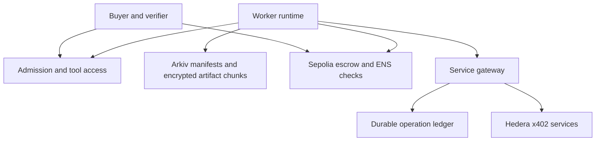

# BATON architecture

Revision: 5 November 2026. Status: design specification, not deployed or integration-verified. Required integrations: Arkiv, ENS and Hedera x402. This revision replaces the earlier architecture scope reflected in context(2).md. The older linked architecture could not be retrieved; this document reconstructs the complete revised design from the accessible current context rather than claiming to preserve unseen details.

Current storage decision: Arkiv holds encrypted checkpoint manifests and all task artifacts, including large inputs and paid outputs. No separate artifact store or independent mirror is planned. SQLite is the selected persistence backend for the buyer-controlled service-payment operation ledger. Keep encrypted content payloads in Arkiv and payment-operation metadata in SQLite. Arkiv entity ownership and renewal authority must be finalized before live storage writes.

## 1. Product and guarantees

BATON coordinates funded work across independent operators. A replacement worker resumes a compatible task from its last accepted checkpoint, with explicit authority, recoverable evidence, fresh tool access and preserved earned rewards. Planned delegation and failure recovery use the same task boundary but different assignment events.

The portable unit is a task with an agreed output contract. It is not an arbitrary live model session. Transfer is conditional on exportable state, accessible artifacts, compatible execution and authorized tools. A worker may use a different approach within the agreed constraints. Model cognition, corporate rights and provider caches do not transfer automatically.

## 2. Components and sources of truth

| Component | Authority and responsibility |
|---|---|
| Sepolia escrow and task registry | Canonical job terms, funded reward schedule, task assignment/epoch, accepted checkpoint commitment, earned credits and refunds. |
| ENS job resolver | Live job-scoped worker grant, checked against the pinned resolver interface. A task additionally requires the escrow assignment. |
| Arkiv content store | Encrypted recovery manifests, exported state, large inputs, transcripts, code/model snapshots and outputs stored as linked entities; queryable discovery metadata. It does not choose the accepted head. |
| Capability registry and admission service | Candidate evidence, hard eligibility filtering, tool/access checks and compatibility reports. Recommendations do not assign authority. |
| Worker runtime and adapters | Import/export task state, call approved tools, reconstruct model context and submit signed offers. |
| Tool and MCP access broker | Establish separately authorized scoped tool connections. It cannot grant rights the resource owner has not approved. |
| Buyer-controlled service gateway | Holds Hedera payer authority, fences old epochs, reserves service budget and submits x402 requests. |
| SQLite operation ledger | Buyer-host record of service intents, reservations, ambiguous outcomes, settlement receipts and paid-output references, recoverable independently of the outgoing worker. It stores metadata and state transitions; encrypted output payloads remain in Arkiv. |
| Buyer console and verification service | Define terms, evaluate evidence, approve checkpoints and assignment, expose receipts and recovery status. |

Sepolia reward accounting and Hedera service accounting are separate. No cross-chain atomicity or automatic shared balance is assumed. The gateway, key service, admission service and buyer/verifier are explicit trust dependencies.

## 3. Job, task and pricing model

A job contains a bounded acyclic task graph. A task owns its own assignment, epoch, milestone sequence and checkpoint head. Concurrent tasks can have different workers. Parent completion requires accepted completion of all required tasks. Dependency edges bind a downstream task to exact accepted upstream output commitments; they must not resolve to mutable “latest” results during execution.

For the demonstration, use one task with three milestones. The design supports multiple tasks without reusing one global worker epoch. Task creation and edges are fixed before funding; graph changes and arbitrary dynamic subtask creation require a later amendment design.

| Record | Required fields |
|---|---|
| JobTerms | buyer, rewardToken, termsHash, taskGraphHash, fundingAmount, cutoff, authority policy, ENS binding, verifier identities |
| TaskTerms | taskId, dependency commitments, requiredCapabilitiesHash, acceptanceSpecHash, transferPolicyHash, deadline, ordered milestone amounts and deliverable hashes |
| TaskState | assignedWorker, epoch, acceptedHead, nextMilestone, status |
| CheckpointHead | manifestCiphertextDigest, Arkiv entity reference, artifactManifestDigest, schemaVersion, checkpointSequence |
| RewardCredit | producingWorker, accepted milestone ID, fixed amount, withdrawal status |
| ServicePolicy | job/task budget, asset/network, approved services, per-request cap, maximum aggregate reservation, policy version |

Buyer and worker agree milestone amounts before assignment. The initial worker signs the terms commitment; B signs the same remaining terms in its takeover acknowledgement. An example milestone representing 30% of processing may earn 10% of the reward. Display progress and payment separately. Do not derive reward from model confidence, token usage or a worker's claimed completion percentage.

Freeze reward and acceptance terms for the first implementation. Renegotiation is unsupported until an amendment protocol can preserve earned credits, explicit consent and budget conservation. No worker or buyer can reduce an already accepted credit.

## 4. Portable checkpoint schema and large context

Serialize a versioned encrypted recovery package with:

- Identity: jobId, taskId, epoch, sequence, previous accepted head, schema and adapter versions.
- Work state: objective, constraints, accepted work, attributed decisions/assumptions, unresolved issues, next actions and acceptance evidence.
- Artifact manifest: encrypted object/chunk references, ciphertext digests, byte lengths, media types, snapshot versions, dependency edges and retention requirements.
- Execution requirements: capability manifest, tool schemas/versions, runtime/image references, model adapter configuration and context reconstruction recipe.
- External operations: stable operation IDs and ledger revision references, paid output references and retrieval entitlement references.
- Optional quantitative state: model/code snapshot, data timestamp, units, parameters, distributions/posteriors or sufficient statistics, uncertainty and evaluation specification.

All task content lives in Arkiv. Small exported state lives in encrypted manifest entities; large corpora, transcripts, model artifacts and outputs are encrypted and split into linked Arkiv chunk entities. Manifests bind exact entity references, chunk order, lengths and ciphertext digests. Split oversized manifests into linked index entities as needed. Upload and read back all required content before accepting its checkpoint commitment. Store deltas and reuse unchanged chunks; periodically create complete recoverable snapshots so reconstruction is bounded. Compression is an optimization, not a promise that an arbitrarily large transcript fits in one entity.

The current Arkiv documentation limits combined `bytes` data in one create or patch to 128 KiB. Measure ciphertext and its stored envelope against this limit; a provisional 96 KiB ciphertext chunk target leaves room for envelope overhead. Entities have a maximum lifetime of 7,884,000 blocks (about 182.5 days) from creation or extension and must be extended before expiry. Only the owner may extend unless `permissionlessExtension` was enabled at creation. Pin the deployed network and SDK limits during integration. These documented limits have not been validated by a live BATON storage probe.

The accepted head commits the exact encrypted manifest and its artifact manifest. Ciphertext integrity uses authenticated encryption; the implementation must use unique nonces and bind job/task/schema metadata as authenticated associated data. Decryption keys stay outside public storage, with buyer-controlled grants to authorized successors. Hashes provide integrity, not availability, authorization or proof of good work.

B loads task instructions, accepted state and relevant evidence into its own model budget, retrieving additional chunks as needed. A 1.5M-token input history need not be replayed in every prompt. If a task actually requires the whole history, admission must select a runtime that can process it or reject the proposed transfer. Compaction can lose information; retain source artifacts and validate the resumed task.

Before acceptance, read back the exact Arkiv manifest and every required artifact chunk and verify their digests. Monitor and fund renewal for every referenced entity through the task and recovery period, with renewal authority that survives A's failure. Entity ownership and the mechanism granting that renewal authority remain open implementation decisions. Arkiv unavailability, expired or missing content, or an unusable decryption key blocks recovery; there is no independent mirror fallback.

## 5. Admission, tools, MCP and cache

Candidates publish signed capability claims with evidence references, supported state adapters, models/runtimes, tool capabilities and commercial constraints. Claims are discovery inputs, not proof of competence.

Admission first checks hard constraints: legal/data transfer permission, required licenses, tools and schemas, state import support, data freshness, budget, deadline and risk permissions. Probe tool access and run a representative conformance case. Rank only eligible candidates using relevant verified results, price and availability. The buyer selects; no ranking score can bypass authorization or grant assignment.

Corp Y must obtain its own permitted connections. An approved equivalent tool is acceptable only if the task allows substitution and the compatibility check passes. A remote Corp X service can remain a dependency only with its owner's authorization and an explicit availability assumption. Otherwise pause or decline transfer. Never copy API keys, MCP bearer tokens, proprietary sessions or restricted data into a checkpoint.

Provider prompt/KV caches are disposable. B reconstructs context and budgets for cold-start cost. Reusable application/tool results are stored as ordinary artifacts keyed by input digest, tool/version and relevant environment, with provenance, freshness and entitlement metadata. A receipt is insufficient to reuse an output unless B also has permitted retrieval access.

## 6. Hedera x402 service purchases

Hedera is required for job-relevant paid data or compute. Keep worker rewards in Sepolia escrow. Route protected service purchases through a buyer-controlled gateway; workers do not receive unrestricted Hedera payer keys.

An authenticated request binds jobId, taskId, current epoch, assigned worker, service, input digest, policy version, stable logical operation ID, request nonce and expiry. Verify worker signatures, live assignment, pause/closure status and confirmed epoch before admission. Reject nonce replay and mismatched reuse of an operation ID. For an identical completed operation, return its authorized stored output; for a pending/unknown one, reconcile it.

The ledger records intent before sending payment. Serialize budget reservation with operation creation. Enforce job and task caps across all concurrent tasks; an in-memory counter is insufficient. Require available budget >= the maximum approved debit. Keep network/facilitator fees in an explicit policy allowance, and reject unexpected assets, payees or price increases.

### SQLite persistence and transaction model

Use one durable SQLite database on the buyer-controlled gateway host, configured by `PAYMENT_LEDGER_PATH` (default `./data/payment-ledger.sqlite`, relative to the server process directory). Only the gateway writes this database. Run one active gateway writer per database file; do not put the file on a network filesystem or use it for active-active gateway replicas. Worker processes use authenticated gateway APIs and never open the ledger file directly.

Use WAL journaling, `synchronous=FULL`, foreign-key enforcement and a bounded busy timeout. Create the operation intent and reserve its maximum approved debit in one `BEGIN IMMEDIATE` transaction. Enforce unique constraints for the stable logical operation key and request nonce. A retry with the same operation key and input fingerprint reads the existing operation; the same key with different job/task/service/input data fails closed. Record state transitions and accounting deltas transactionally so restart reconciliation can distinguish INTENT, RESERVED, SUBMITTED, SETTLED, OUTPUT_AVAILABLE, FAILED and UNKNOWN.

UNKNOWN retains its reservation until an authoritative reconciliation resolves settlement. A confirmed settlement converts the reservation to spend once; confirmed non-settlement releases it. Keep the receipt, provider reference, output digest and Arkiv entity references in SQLite. Keep paid output bytes encrypted in Arkiv. Never store plaintext tool results, private keys or bearer tokens in the ledger. Persist the SQLite data directory on a durable local volume and use SQLite's consistent backup/checkpoint mechanism before copying database files; recover pending operations before reopening gateway admissions after restart.

The database path and ledger implementation are local configuration, not secrets. Ignore the main database and its WAL/SHM sidecars in Git. Live x402 requests remain disabled until atomic reservation, concurrency, restart and UNKNOWN-state reconciliation tests pass.

Operation states: INTENT, RESERVED, SUBMITTED, SETTLED, OUTPUT_AVAILABLE, FAILED and UNKNOWN. A settled payment lacking an output is not a refundable failed request. UNKNOWN keeps its reservation until definitive reconciliation. Settlement converts the reservation into spent funds; verified non-settlement releases it. Encrypt recovered service outputs, persist them in Arkiv and verify readback before marking them durably available. An Arkiv write failure after settlement preserves the settled/unknown-output state and triggers reconciliation rather than a second payment.

Budget invariant, per asset: serviceDeposits = available + reserved + settledSpend + returnedFunds. No automatic conversion between HBAR, stablecoins and Sepolia reward tokens is assumed. SQLite ledger entries bind settlement receipts to request and output digests. Checkpoints copy references; the durable ledger remains authoritative for in-flight purchases independently of worker checkpoints. SQLite must demonstrate atomic reservation, concurrency control, durability and reconciliation before paid requests are enabled; selecting a backend does not establish those properties.

The paid endpoint must support stable operation IDs and retrieving previously purchased results for the buyer-authorized successor. On a timeout, query ledger, facilitator/network settlement and provider status before retrying. x402 alone does not guarantee exactly-once service execution, portable entitlements or duplicate-charge prevention. If an outcome cannot be determined, block that operation and request reconciliation; do not silently repay.

## 7. Checkpoint acceptance and takeover

Checkpoint acceptance:

1. A exports/encrypts state and stages the Arkiv package and artifacts.
2. Verification checks deliverables, compatibility metadata, exact Arkiv manifest/chunk readback and retention coverage. Service receipts are reconciled separately; pending operations remain visible.
3. A signs a milestone offer bound to the exact terms, checkpoint and expected head. The buyer submits acceptance with any required named verifier signature.
4. The escrow verifies assignment, epoch, live ENS grant, expected head, milestone order, terms and deadline. It updates the head and credits the fixed milestone amount atomically.

Takeover:

1. Buyer starts a gateway drain for the task; stop admitting new A requests. Reconcile submitted operations or keep the task blocked while uncertainty remains.
2. B reads the confirmed escrow head, verifies the manifest/artifacts and passes admission with fresh tool access. B can validate historical state before it has spending authority.
3. B signs an acknowledgement binding exact head, current epoch, remaining terms, compatibility report and service policy. It does not treat a copied budget number as authoritative.
4. Buyer installs B's live ENS grant and submits takeover. The contract compares exact head/epoch, increments the task epoch and assigns B without altering head or credits.
5. Gateway waits for the configured confirmation level and rechecks the assignment. It grants B fresh scoped access and resumes admissions. A's old-epoch requests are rejected.

If A's acceptance changes the head before takeover, takeover reverts; B recovers the new head and signs again. If takeover executes first, A's stale acceptance fails. Unexpected head, RPC disagreement or reorg closes gateway admissions until reconciled. A failed takeover leaves the task drained until the buyer explicitly resumes the confirmed current worker or retries.

Already authorized or settled external actions cannot be revoked by an epoch change. Direct third-party credentials issued to A require separate owner-side revocation. Reads already disclosed to A cannot be undisclosed. No claim of universal external revocation is made.

## 8. Authority, veto and probabilistic decisions

Buyer approves assignment and takeover. Each task names its verifier before funding; acceptance requires buyer authorization plus any required verifier attestation. Deterministic evidence can be checked automatically by that service, but an off-chain check is not an on-chain proof of truth. Buyer can pause new acceptance and gateway admissions; workers may decline work.

The contract enforces frozen terms and signature authority. A's methodology is advisory unless the terms require it. B can change methods within those terms. Neither A nor B has a retroactive veto on accepted work. Parent tasks cannot rewrite child credits. Buyer refusal to accept unaccepted work remains a trust limitation; the design does not supply independent arbitration or automatic fair compensation for rejected work.

Probabilistic agents use an explicit export/import adapter and acceptance contract. Preserve input snapshots, assumptions, distributions, uncertainty and evaluation artifacts rather than only a final numeric answer. Random seeds alone do not ensure reproducibility across models/hardware. A proprietary agent unable to export required state is incompatible unless the task explicitly permits continuation from signed outputs.

Evaluate evidence and agreed procedure at delivery. Evaluate forecast quality over resolved cases using suitable calibration/scoring criteria; a single outcome cannot certify a probability estimate. Keep consequential execution behind separately granted risk limits. Jev-specific adapter compatibility has not been inspected or established.

## 9. Contract surface and invariants

Proposed methods: fundJob(terms, taskTerms), assignTask(taskId, signedConsent), acceptMilestone(taskId, offer, verifierAttestation), takeover(taskId, acknowledgement), pause(jobId), resume(jobId), close(jobId), claim(). Exact Solidity ABI remains to be implemented and reviewed.

Use EIP-712 domains and distinct action types. Bind job/task IDs, chain, contract, terms hash, epoch, expected head, milestone/checkpoint, participants, amounts where applicable, nonce and expiry. Verify the pinned ENS resolver and grant semantics; discovery text records alone must not authorize contract actions.

Pause blocks acceptance and takeover; resume is buyer-only before cutoff. At or after cutoff anyone can close; completed jobs can close earlier. Closure rejects new work, refunds unallocated rewards and preserves outstanding worker credits. Gateway blocks new spend on pause or closure after its confirmed-state check, subject to the disclosed external-operation boundary. Already accepted credits remain claimable while paused or closed. Use checks-effects-interactions and a reentrancy guard for withdrawals.

Reward invariant: totalFunded = unallocated + outstandingCredits + outstandingRefunds + totalWithdrawn. Per-task milestone allocations sum to job funding and are consumed once. One acceptance credits only its producing assigned worker. Task dependency and milestone order are enforced. Each transition checks status and deadline; accepted heads are append-only by sequence. Fresh grants never substitute for an exact task assignment.

## 10. Implementation modules

| Module | Main responsibility |
|---|---|
| server/contracts/src/JobEscrow.sol | Job/task state, rewards, signatures, assignment and closure |
| server/contracts/src/JobAuthority.sol | Pinned ENS permission adapter |
| server/packages/checkpoint | Canonical serialization, encryption, hashes and schema validation |
| server/packages/storage | Arkiv manifest/chunk adapters and retention monitoring |
| server/packages/runtime | Export/import interface and context reconstruction |
| server/src/services/admission | Eligibility, tool probes, conformance and candidate ranking |
| server/src/services/access | Scoped credential grants and revocation coordination |
| server/src/services/payments | Gateway, x402 client, budget reservations and settlement reconciliation |
| server/services/ledger | SQLite-backed durable operation history and recovery queries; implementation pending |
| server/src/services/verifier | Deliverable checks and signed acceptance evidence |
| client and server/src/worker | Buyer console, worker execution and receipts |

The repository contains the client/server scaffold, D2 checkpoint/runtime/storage adapters, local worker and MCP scenarios, and API status routes. Contract authority and the SQLite payment ledger remain unimplemented; live Arkiv, ENS, Sepolia and Hedera behavior remains unverified.

## 11. Acceptance scenarios

| Scenario | Required result |
|---|---|
| A fails after milestone 1 | B recovers exact accepted state, completes remaining work; A keeps its earned reward |
| Large input history | B retrieves required verified artifacts without assuming the whole transcript fits one prompt |
| Missing Corp X tool/access | Admission declines or approved equivalent passes conformance |
| B changes approach | Allowed within frozen deliverable and risk constraints |
| 30% progress / 10% reward | Contract credits agreed amount; interface displays distinct percentages |
| Payment settles before checkpoint, then A dies | B recovers receipt/output using independent ledger without paying again |
| Payment times out | Reservation stays held until outcome is known; no blind retry |
| Concurrent tasks spend | Global and per-task caps hold under atomic reservations |
| Head changes during takeover | Old acknowledgement fails; B must recover and re-sign |
| Old A submits after takeover | Both stale milestone and gateway spending are rejected |
| Arkiv unavailable or expired | Recovery and takeover fail closed until exact verified content is available; expired content has no mirror fallback |
| Probabilistic state import | Versioned adapter restores required state or rejects incompatibility |
| Task dependencies | Downstream input binds exact accepted upstream commitment |
| Pause, cutoff and withdrawal | New work stops according to rules; credits survive; only unallocated funds refund |

Required live demonstration: separate A/B hosts; actual Arkiv recovery; live ENS grant checks; real Hedera testnet x402 settlement for a required service; crash after settlement before checkpoint; rejected stale A requests; both reward withdrawals. A self-hosted paid service must be disclosed as such.

Earlier context reports 22 local tests and 100,000 randomized state-transition attempts using simulated storage. Those historical results do not validate this revised per-task contract, Hedera gateway, admission, probabilistic adapters or live integration. All revised mechanisms require implementation and verification.

## References

Current context: context.md. Arkiv limits and expiration documentation checked 5 November 2026 during setup; deployment compatibility and live integrations remain unverified.

- Arkiv: https://docs.arkiv.network/reference/limits/ and https://docs.arkiv.network/writing/expiration/
- MCP authorization: https://modelcontextprotocol.io/specification/2025-11-25/basic/authorization
- Anthropic caching: https://platform.claude.com/docs/en/build-with-claude/prompt-caching
- Hedera x402: https://hedera.com/blog/hedera-and-the-x402-payment-standard/
